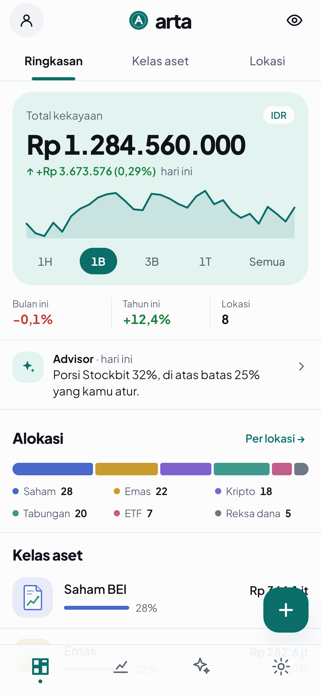
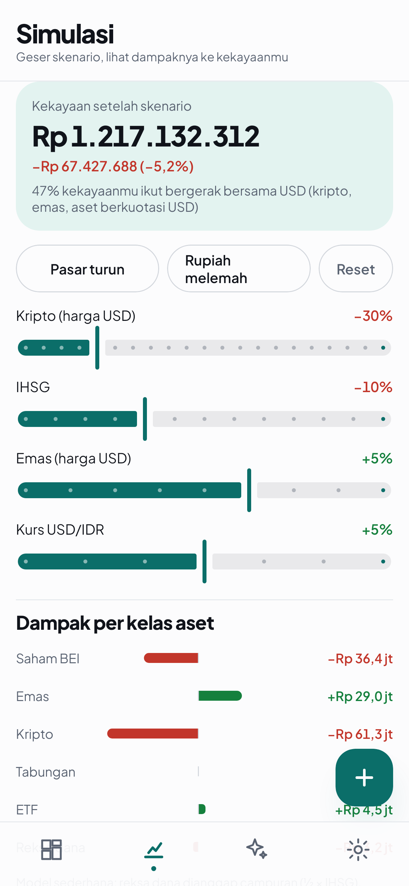
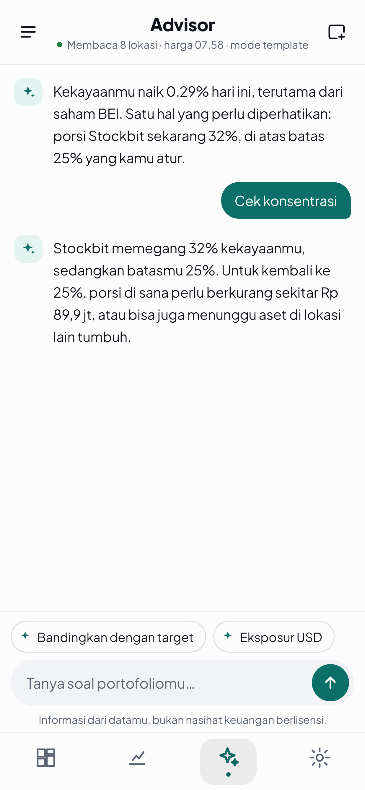
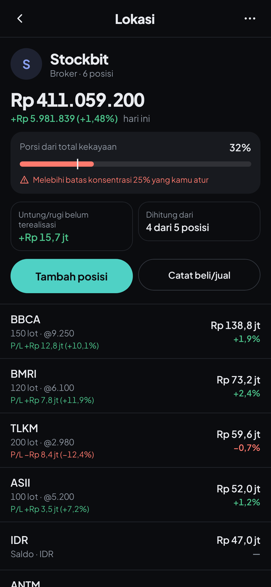

# Arta

Aplikasi Android pribadi untuk mencatat semua aset (saham BEI, ETF, reksa dana, kripto, emas, tabungan, aset lain) dengan nilai mengikuti harga & kurs terbaru. **Local-first**: tanpa backend, database terenkripsi di perangkat.

Spesifikasi: `CLAUDE.md`, `docs/SPEC.md`, `docs/ARCHITECTURE.md`, `docs/DESIGN.md`, mockup di `design/`.

| Ringkasan | Simulasi | Advisor | Detail lokasi (gelap) |
|---|---|---|---|
|  |  |  |  |

Tablet lanskap (navigation rail + panel Advisor): `docs/screenshots/31_tablet_ringkasan.png`.

## Build

Butuh JDK 17+ dan Android SDK (compileSdk 37.1).

```bash
cp local.properties.example local.properties   # isi sdk.dir; LLM_* boleh kosong (mode template)
./gradlew :app:assembleDebug                   # APK debug (ada "Isi data demo" di Pengaturan & onboarding)
./gradlew :app:testDebugUnitTest               # 55 uji unit + screenshot (app/build/screenshots)
./gradlew :app:assembleRelease                 # R8 aktif; sementara ditandatangani kunci debug
```

Versi library: AGP 9.5.2, Kotlin 2.4.21, Compose BOM 2026.11.01, Room 2.8.5 + `net.zetetic:sqlcipher-android` 4.20.0, Haze 2.1.0, Ktor 3.6.1, WorkManager 2.12.0 (semua di `gradle/libs.versions.toml`).

## Status milestone

| | |
|---|---|
| M1 Fondasi | ✅ version catalog, token & tipografi Plus Jakarta Sans (bundled, OFL di `licenses/`), 4 tab + FAB |
| M2 Keamanan & data | ✅ passphrase acak dibungkus AES-GCM Keystore (StrongBox→TEE), Room+SQLCipher, BiometricPrompt + kredensial perangkat, layar pemulihan, backup off, blokir tangkapan layar opsional (default mati) |
| M3 Pencatatan | ✅ CRUD lokasi, sheet Tambah posisi bertahap, catat beli/jual/setor/tarik, detail lokasi & posisi, harga manual |
| M4 Harga | ✅ CoinGecko, Yahoo Finance, Frankfurter (ECB), emas spot (`GC=F` ÷ 31,1034768), cache, WorkManager, penanda basi |
| M5 Ringkasan | ✅ total + grafik Canvas + rentang, statistik, insight, alokasi, kelas aset, lokasi, snapshot harian |
| M6 Simulasi | ✅ slider step 5 %, preset, dampak per kelas |
| M7 Advisor | ✅ engine lokal, `LlmClient` + `ProviderLlmClient` **placeholder** (`TODO(owner)`), mode template, kartu simulasi, riwayat |
| M8 Pengaturan & polish | ✅ semua setelan, ekspor CSV (SAF), hapus semua (konfirmasi ganda), rail tablet + dua panel, mode kaca ringan otomatis |

## Untuk pemilik

- **LLM**: isi `LLM_API_KEY/BASE_URL/MODEL` di `local.properties`, lalu implementasikan request di `app/src/main/java/id/shoko/arta/llm/ProviderLlmClient.kt` (cari `TODO(owner)`). Sampai itu, Advisor otomatis memakai mode template.
- **Endpoint harga** belum diuji dari perangkat nyata (lingkungan build tidak punya akses ke host tsb). Parser diuji dengan fixture di `app/src/test/resources/fixtures`. Ketentuan: CoinGecko publik tanpa key dibatasi ±5–30 panggilan/menit; Yahoo tidak resmi dan bisa berubah (kegagalan → harga lama + label basi).
- **Release signing**: build release memakai kunci debug; ganti dengan keystore sendiri.

## Penyimpangan kecil dari spesifikasi (sengaja)

1. `price_latest.prev_close` ditambahkan (penutupan kemarin dari sumber) untuk perubahan hari ini; `price_history` tetap diisi.
2. Kas RDN di broker dihitung sebagai **Tabungan**, jadi pada data demo kelas Saham = Rp 364,1 jt (28 %) dan Tabungan = Rp 252,5 jt; total & porsi lokasi tetap sama dengan SPEC §5.
3. WorkManager menambahkan izin normal (tanpa dialog) `ACCESS_NETWORK_STATE`, `WAKE_LOCK`, `RECEIVE_BOOT_COMPLETED`, `FOREGROUND_SERVICE`. Izin yang diminta Arta sendiri hanya `INTERNET`, `USE_BIOMETRIC`, `POST_NOTIFICATIONS`.
4. Bila kunci sidik jari aktif, worker latar tidak bisa membuka DB saat app tertutup (kunci Keystore butuh autentikasi) — refresh terjadi saat app dibuka/di-resume. Matikan kunci sidik jari bila ingin update di latar.
5. DI manual (`AppContainer`) alih-alih Koin, sesuai opsi "Koin (atau manual)".
6. Uji instrumented (SQLCipher passphrase benar/salah, migrasi) belum ditulis karena belum ada perangkat/emulator; screenshot UI dibuat lewat Robolectric dengan DB in-memory.
